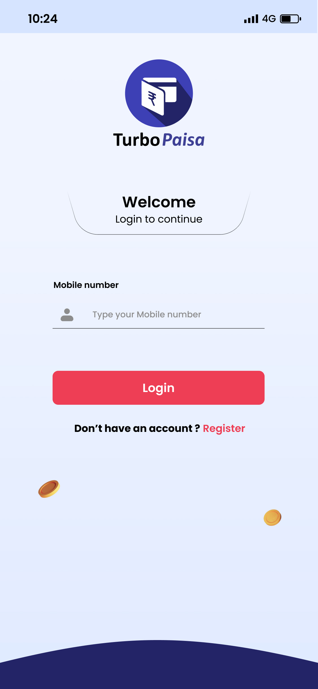
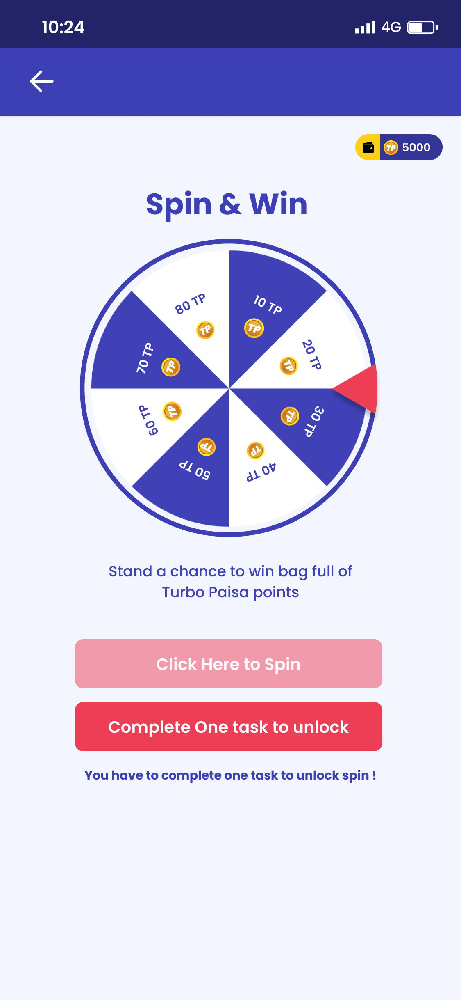
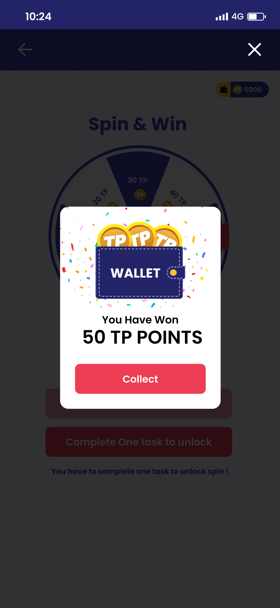
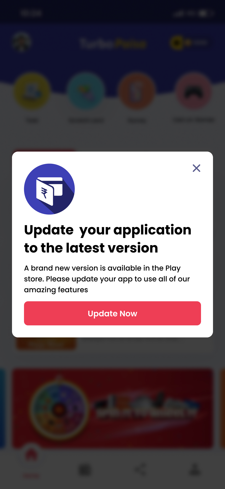
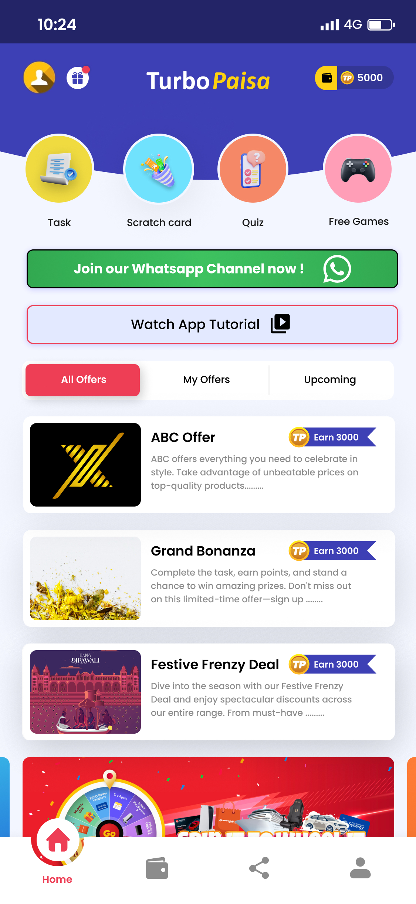
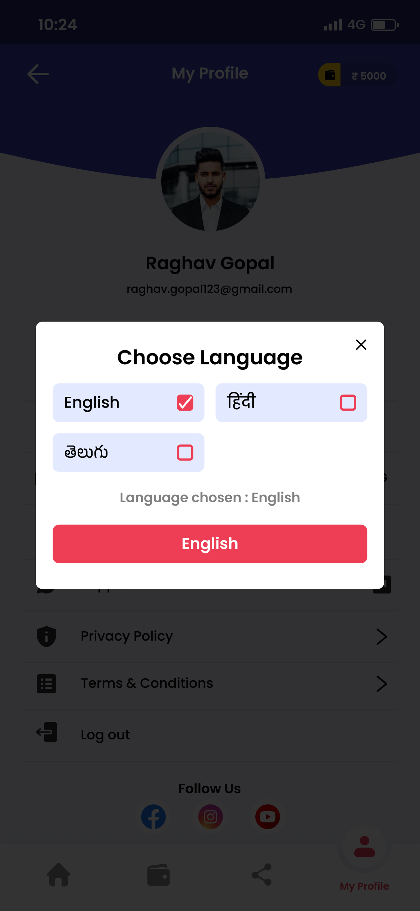

# UI/UX Case Study: Three Application Experiences

## Scope and method

This case study reviews the screen images in the `Credbuddha v-2 (Copy)`, `CVM HRM`, and `turbopaisa` folders. Screens are grouped by product area, and the flows below are reconstructed from the visible screens and their filenames; they are not verified against a running application. No usability research, implementation behavior, or accessibility testing was provided.

The image links are relative to this document. Keep the three source folders beside this file for the galleries to render. ZIP archives are source packages rather than screen images, so they are not embedded.

## Portfolio overview

| Folder / product | Platform indicated by screens | Primary experience | Main areas represented |
|---|---|---|---|
| `Credbuddha v-2 (Copy)` | Mobile | Discover lending and credit products, apply, and manage an account | Onboarding, sign-in, loan application and outcomes, credit card, profile, referrals |
| `CVM HRM` | Desktop web | Employee and HR operations in a role-based portal | Dashboard, self-service, onboarding, assets, attendance, HR requests, leave, team, management |
| `turbopaisa` | Mobile | Discover earning activities, rewards, and wallet functions | Authentication, home/offers, wallet, games and challenges, referral, profile and settings |

---

# 1. Credbuddha

## Product and experience summary

The screens present a mobile financial-services app centered on loan discovery and applications, with credit-card offers and account/profile features alongside the lending journey. A navy-and-white interface, green highlights, prominent full-width actions, and illustrations establish the visual language. The application flow is split into two detail forms and communicates three different review outcomes: pending, approved, and rejected.

### Screen categories

#### Welcome, registration, and sign-in

The first group covers the welcome screen, mobile-number sign-in, account details, SMS OTP, and registration confirmation. The two OTP files are byte-identical copies.

#### Home, pre-approved offers, and loan application

The home and pre-approved-loan screens act as discovery points. The application screens show a two-step form, followed by separate submission, approval, and rejection states.

#### Credit card offer

The credit-card screen promotes an offer and presents a Continue action. The subsequent application screens are not in the supplied set.

#### Profile and referral

These screens provide profile settings and an invite/share entry point. The profile edit form and profile overview are distinct screens.

### Simple screen flows

- **Create an account:** Welcome → Register → enter name, mobile number, pincode, income, and employment status → create account → enter SMS OTP → success/confirmation.
- **Sign in:** Welcome or sign-in entry → enter mobile number → Login → OTP verification → authenticated home. The OTP-to-home transition is inferred; no post-login confirmation screen is supplied.
- **Apply for a loan:** Home or pre-approved offers → loan introduction / partner offer → enter contact, requested amount, email, name, and pincode (step 1) → enter gender, employment, PAN, and address (step 2) → submit → pending review → approved **or** rejected. The outcome screens are alternatives, not sequential steps.
- **Edit profile:** Profile → Edit Profile → update details → Save → return to profile. A saved-state confirmation is not shown.
- **Refer a friend:** Home/profile entry point → Referral Bonus → copy referral ID or select a social channel → Continue.
- **Explore a credit card:** Home or card tab → Credit Card offer → Continue → application flow not shown.

### UX observations and opportunities

- The loan journey has clear entry points and explicit success/failure states. Keep the pending state distinct from final approval so users understand that submission is not approval.
- The two-step application is a useful way to divide a dense form. Add a visible step indicator, explain why sensitive details such as PAN are needed, and retain entered information when navigating backward.
- The account and loan forms collect personal and financial data. Use field-level validation, appropriate input types, privacy reassurance, and clear handling of invalid or unavailable values.
- The OTP screen should communicate resend timing, code length, and recovery options; provide accessible focus movement and a clear error state.
- The pre-approved list repeats similar offer content. Distinguish providers, eligibility, fees, repayment terms, and the basis for “pre-approved” before the user commits.
- Keep the credit-card offer and loan product navigation consistent with the bottom navigation and provide a clear return path after partner/application steps.

---

# 2. CVM HRM

## Product and experience summary

The CVM HRM screens depict a desktop employee-management portal with a persistent left navigation rail, global search/header, pale-lavender workspace, white content cards, and bright green selection/action accents. The product combines employee self-service and HR/admin workflows. Tables, filters, status labels, summaries, and modal dialogs are used across modules.

### Screen categories

#### Overview dashboard

The dashboard combines employee context and shortcuts with attendance, time tracking, announcements, and upcoming events.

#### Employee self-service and profile

The screens show profile information, address details, emergency contacts, and an edit/save state.

#### Employee onboarding

This group covers the onboarding dashboard, employee list, add-employee form, onboarding progress list, and a detailed progress view.

#### Asset management

The asset area includes a summary dashboard, inventory list, employee asset requests, and a create-asset dialog.

#### Attendance and timesheets

The screens show a calendar and clock-in summary, employee timesheet entry, a manager timesheet review table, detail inspection, and a rejection-reason dialog.

#### HR requests

The HR request screen provides a searchable, filterable request list with status and review actions.

#### Leave self-service and administration

The employee leave dashboard presents balances, trends, and request history. The management screens show request review, application, and request details.

#### Team management

The team screen groups employees by department and includes search, filters, and an add-member action.

#### Company management: announcements, events, and holidays

These screens share a management workspace for publishing announcements, scheduling events, and maintaining holidays; recent admin activity is also visible.

### Simple screen flows

- **Employee self-service:** Dashboard → Self-Service → Profile → expand Personal Information, Address, or Emergency Contacts → Edit → Save Changes → updated profile. The screenshots do not show a save confirmation.
- **Add and onboard an employee:** Onboard → Employees → Add Employee → enter identity, contact, role, department, and employment details → Add Employee → Onboarding Progress → open employee details → monitor document, verification, training, equipment, orientation, and approval progress.
- **Review an asset request:** Assets → Asset Request → search/filter by status → inspect request → approve or decline → reflect the result in the request list/asset inventory.
- **Create and track an asset:** Assets → Create Asset → enter asset type, description, purchase date, assignment, status, and tag → Create → Asset List/dashboard.
- **Submit a timesheet:** Attendance → Timesheet → select a date → add project, task description, and hours → review entries → Submit for Approval → manager reviews in Timesheet Dashboard.
- **Review a timesheet:** Timesheet Dashboard → filter/search → open details → Approve **or** Reject → if rejecting, enter a reason and confirm → status updates in the list.
- **Apply for leave:** Leave Dashboard → Apply Leave → choose leave type and dates, select half-day if needed, enter reason → Submit → request appears in the employee history and manager’s Leave Management list.
- **Review leave:** Leave Management → filter/search → open request details → approve or reject → updated status appears in the list.
- **Handle an HR request:** HR Requests → search/filter → inspect a request → take the available review action → status updates.
- **Publish company information:** Management → choose Announcements, Events, or Holidays → enter title/message or date/time → Add → review the resulting list and recent admin activity.
- **Browse a team:** Team → search/filter by position and department → expand a department → review employee records or Add Member.

### UX observations and opportunities

- The persistent navigation and module tabs make a broad suite discoverable, but the many modules and similar table layouts increase wayfinding demands. Keep labels and selected states consistent and provide breadcrumbs or page titles for deep workflows.
- Status colors are useful for scanning, but pair every color with text and an icon so state is not conveyed by color alone. Use consistent names for related statuses across assets, timesheets, leave, and onboarding.
- Approval and rejection are consequential actions. Provide a clear confirmation, capture a meaningful rejection reason, and display who acted and when. The rejection-reason screen is a useful pattern to extend consistently.
- Use explicit labels and valid examples in forms. Some supplied asset fields appear to have generic or mismatched placeholders; replace them with field-specific hints and validation.
- Dense tables benefit from predictable sorting, filter reset, empty states, clear pagination, keyboard-accessible row actions, and visible export feedback.
- The employee-facing leave dashboard and admin leave queue have different goals. Keep the employee balance/request status prominent in self-service and reviewer workload/decision context prominent in the admin view.
- The sample screens show sample employee names and contact details. Use synthetic data in any shared or published case study.

---

# 3. TurboPaisa

## Product and experience summary

The TurboPaisa assets show a mobile rewards/earnings product with a colorful home screen, offer cards, task and game entry points, wallet screens, referrals, and account settings. The UI emphasizes earning opportunities and balances using bright colors and compact bottom navigation. Several screens have numbered variants, suggesting alternate captures or states; filenames alone do not establish which version is current.

### Screen categories

#### Intro, tutorial, and authentication

The assets include an introductory promotional/video frame, two splash exports (byte-identical), login, and two sign-up captures.

#### Home and offer discovery

Two home captures provide entry to tasks, scratch cards, quizzes, games, offer filters, and featured offers.

#### Wallet and bank details

The wallet screens are grouped as multiple named variants because their precise state progression is not clear from filenames alone. Bank Details is the related payout/account setup screen.

#### Tasks, games, and challenges

These screens cover scratch cards, spins and a spin popup, weekly challenges, and an update page. They represent engagement/reward interactions; the assets do not establish the rules or payout conditions.

#### Referral and sharing

The referral screens provide a referral/earn entry point and support sharing through WhatsApp.

#### Profile, language, and settings

The account screens include profile, language selection, and related personal/payment details.

### Simple screen flows

- **Create an account and enter the app:** Splash → Sign Up → complete registration → home. Returning user: Splash → Login → authenticate → home. Intermediate verification is not shown in these captures.
- **Discover an earning activity:** Home → choose Task, Scratch Card, Quiz, Free Games, or an offer → complete the activity → see result/reward → check Wallet. The exact reward rules and confirmation states need product validation.
- **Play a spin activity:** Home or task entry → Spin → review any Spin popup → participate → result/reward → Wallet. The popup’s exact timing and meaning are not clear from the filenames.
- **Complete a weekly challenge:** Home → Weekly Challenge → review tasks/progress → complete eligible activities → claim or track reward → Wallet. Claim and completion screens are not confirmed in the supplied images.
- **Check rewards or payout details:** Bottom navigation → Wallet → review balance/transactions → Bank Details if payout setup is required. The screenshots do not establish payout eligibility or transaction states.
- **Refer a friend:** Home/profile → Refer & Earn → follow WhatsApp tutorial or share referral details → friend joins/completes qualifying action → track earned reward. Qualifying conditions should be shown before sharing.
- **Change language:** Profile → Language → choose a supported language → apply selection → return to localized app. Verify that every supported language is fully translated and that layout supports longer labels.
- **Manage profile:** Bottom navigation → My Profile → update account/settings or open bank details/language → save or return. A save confirmation is not represented in the screenshots.

### UX observations and opportunities

- Make the primary earning action and the distinction between an offer, a task, a game, and a cash reward immediately clear. State reward amounts, qualifying steps, limits, and expiry before users start.
- Keep the wallet balance and its units unambiguous. Separate pending, available, and redeemed balances, and provide transaction history and payout status.
- Confirm game outcomes with a clear result screen and explain whether rewards are guaranteed, conditional, or chance-based. Make terms accessible before play.
- Build trust in referrals by making eligibility, attribution, reward timing, and sharing permissions transparent; keep the WhatsApp tutorial optional and provide a non-WhatsApp route.
- Preserve visible navigation and consistent hierarchy across colorful promotional content. Avoid letting banners and offer cards obscure wallet access or core task progress.
- The numbered variants should be compared and labeled as versions/states in the source library; use one canonical image per screen state in handoff to reduce implementation ambiguity.
- Confirm that language selection updates the full product, not just the settings modal, and test text expansion, font rendering, and input behavior for each language.

---

## Cross-product design recommendations

1. **Use consistent action hierarchy.** Make the primary action visually distinct, use stable labels, and avoid competing calls to action on a single screen.
2. **Make status and next steps explicit.** Every submitted request should confirm receipt, explain what happens next, and provide a route back to its status.
3. **Design complete states, not only happy paths.** Include validation, loading, empty, offline, retry, success, and failure states for forms, approvals, wallet operations, and game rewards.
4. **Protect personal information.** Explain why sensitive data is requested, minimize collection, and show privacy information near relevant forms.
5. **Improve accessibility.** Maintain readable contrast, scalable text, descriptive control labels, keyboard/focus support on desktop, and non-color status cues.
6. **Keep the design library unambiguous.** Use consistent filenames and screen/state labels; distinguish exact duplicates from alternate states and mark the canonical version.

## Asset inventory notes

- Credbuddha includes two byte-identical OTP verification files.
- TurboPaisa includes two byte-identical splash-screen files.
- CVM HRM includes `Text.jpg`, a 632-byte file that is not a usable screen image; it is intentionally omitted from the gallery.
- The product flows are best-effort interpretations of the supplied screens. Validate terminology, decision rules, navigation, and screen order with the product team before treating them as definitive specifications.
